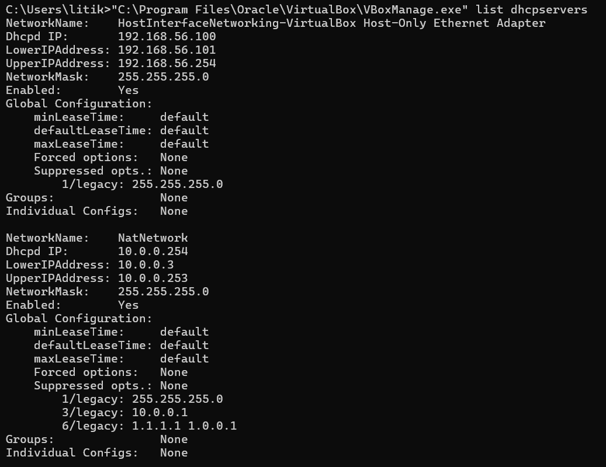
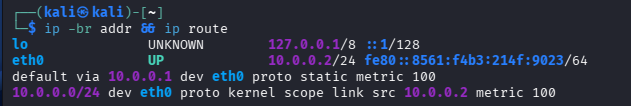
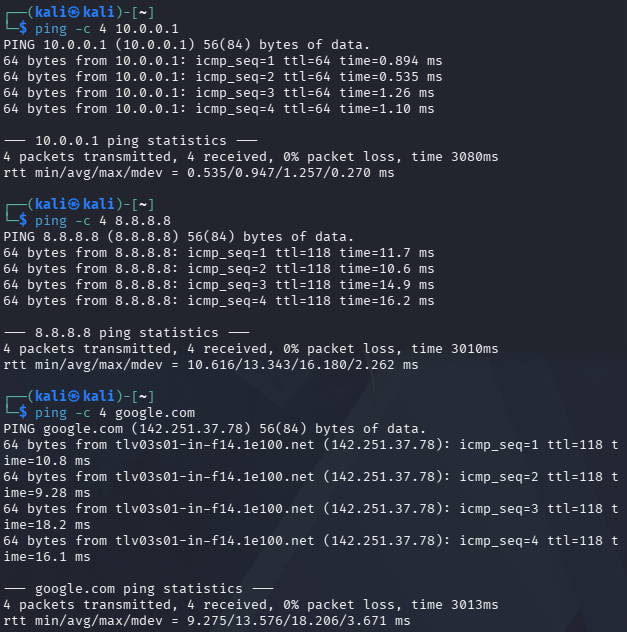
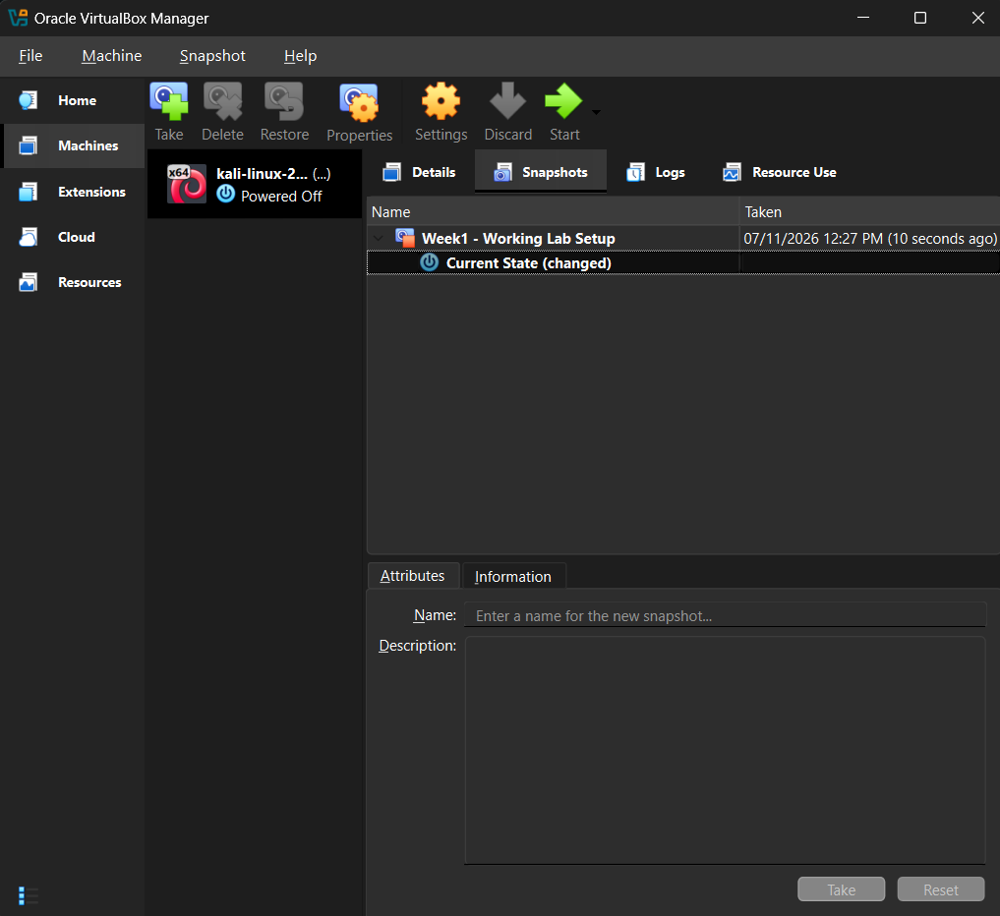
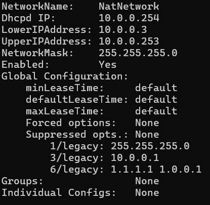
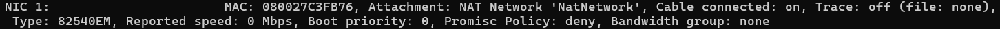
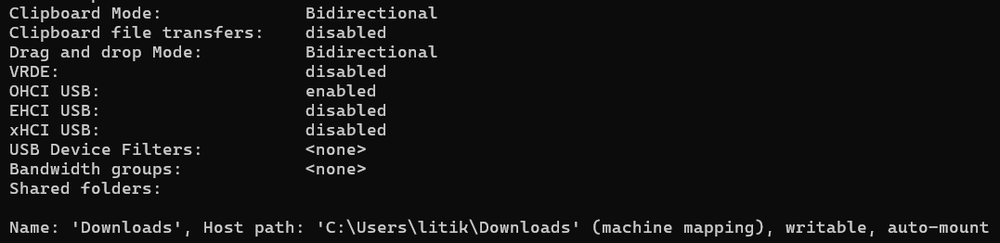

# 🛡️ Cybersecurity Lab Setup

A beginner-friendly cybersecurity lab environment built using Kali Linux and Oracle VirtualBox. This project documents the installation, configuration, and verification of a virtual machine for cybersecurity learning and practical exercises.

## 📌 Project Overview

The goal of this project is to create a virtual environment where cybersecurity tools and networking concepts can be explored safely without making changes to the host operating system.

This repository documents the initial lab setup, including virtual machine configuration, network configuration, connectivity testing, shared resources, and supporting evidence.

## 🧰 Tools & Technologies

- **Kali Linux 2026.3** – Linux distribution used for cybersecurity and penetration testing.
- **Oracle VirtualBox** – Virtualization software used to run Kali Linux.
- **Windows 11** – Host operating system.
- **VirtualBox NAT Network** – Provides network connectivity to the virtual machine.
- **Linux Terminal** – Used to configure and test the Kali environment.
- **Windows Command Prompt (CMD)** – Used to manage and verify VirtualBox network settings.

## ⚙️ Virtual Machine Configuration

The following configuration was used for the Kali Linux virtual machine.

| Setting | Configuration |
|---|---|
| Operating System | Kali Linux 2026.3 (64-bit) |
| Virtualization Software | Oracle VirtualBox |
| RAM | 2048 MB (2 GB) |
| CPUs | 2 |
| Network Adapter | NAT Network |
| NAT Network Name | `NatNetwork` |
| Shared Clipboard | Bidirectional |
| Drag and Drop | Bidirectional |
| Shared Folder | Windows Downloads folder |

## 🌐 Network Configuration

The Kali Linux virtual machine uses a NAT Network named `NatNetwork`.

| Network Setting | Value |
|---|---|
| Network Address | `10.0.0.0/24` |
| Kali Static IP Address | `10.0.0.2/24` |
| Default Gateway | `10.0.0.1` |
| DHCP Server | `10.0.0.254` |
| DHCP Address Range | `10.0.0.3 – 10.0.0.253` |
| Primary DNS | `1.1.1.1` |
| Secondary DNS | `1.0.0.1` |

The Kali virtual machine was assigned a static IP address, while the VirtualBox NAT Network provides DHCP configuration for devices using automatic address assignment.

## ✅ Connectivity Verification

Network connectivity was tested using the following commands in the Kali Linux terminal.

**1. Test connectivity to the default gateway**

```bash
ping -c 4 10.0.0.1
```

**2. Test internet connectivity using a public IP address**

```bash
ping -c 4 8.8.8.8
```

**3. Test DNS resolution and internet connectivity**

```bash
ping -c 4 google.com
```

All three connectivity tests completed successfully:

- Gateway connectivity: Successful
- Internet connectivity: Successful
- DNS resolution: Successful
- Packet loss: 0% across all three tests

## 📸 Evidence & Screenshots

The following screenshots document the configuration and successful verification of the cybersecurity lab environment.

### 1. DHCP Configuration



### 2. Kali IP Address and Routing Configuration



### 3. Network Connectivity Tests



All three connectivity tests completed successfully with 0% packet loss.

### 4. Virtual Machine Snapshot



A snapshot named `Week1 - Working Lab Setup` was created to preserve the initial working configuration.

### 5. NAT Network DHCP Configuration



### 6. Virtual Machine Hardware and Network Configuration

**Memory Allocation (2048 MB)**


**CPU Allocation (2 CPUs)**


**Network Adapter Configuration**



### 7. Shared Resources and Integration



This confirms that bidirectional clipboard, drag and drop, and the shared Downloads folder are configured.

## 💾 Virtual Machine Snapshot

A VirtualBox snapshot named `Week1 - Working Lab Setup` was created after completing the initial configuration.

This snapshot provides a restore point that can be used to return the virtual machine to its working state if future experiments cause configuration issues.

## 📁 Repository Structure

All screenshots and the README file are stored in the root directory of the repository.

```text
NETWORKWALKS-LITIK-B084-WK1-PM1-CYBERSECURITY-LAB-SETUP/
│
├── 01-dhcp-configuration.png
├── 02-kali-ip-configuration.png
├── 03-connectivity-tests.png
├── 04-kali-snapshot.png
├── 05a-nat-network-dhcp.png
├── 05b-1-kali-vm-hardware-network-memory.png
├── 05b-1-kali-vm-hardware-network-nic1.png
├── 05b-1-kali-vm-hardware-network-numberofcpus.png
├── 05b-2-kali-vm-integration.png
│
└── README.md
```

## 🎯 Learning Objectives

Through this initial setup, I gained practical experience with:

- Installing and configuring a Kali Linux virtual machine.
- Understanding virtualization and virtual machine resources.
- Configuring NAT networking in VirtualBox.
- Assigning a static IP address and understanding DHCP.
- Understanding default gateways and DNS servers.
- Testing network connectivity using Linux commands.
- Configuring shared folders between a host and guest operating system.
- Configuring VirtualBox integration features.
- Creating and managing virtual machine snapshots.

## 🚀 Future Work

This repository will serve as the foundation for future cybersecurity lab exercises, including:

- Network reconnaissance.
- Network scanning and enumeration.
- Vulnerability assessment.
- Practical security testing.
- Further exploration of cybersecurity tools and concepts.

## 📚 References

- [Kali Linux Official Website](https://www.kali.org/)
- [Kali Linux Documentation](https://www.kali.org/docs/)
- [Kali Linux Installation Guide](https://www.kali.org/docs/virtualization/install-virtualbox-guest-vm/)
- [Oracle VirtualBox](https://www.virtualbox.org/)

---

**Disclaimer:** This lab is intended for educational purposes. Any security testing should only be performed on systems and networks for which permission has been granted.
